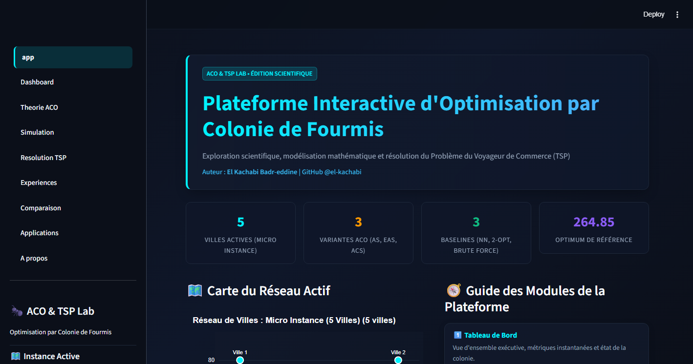
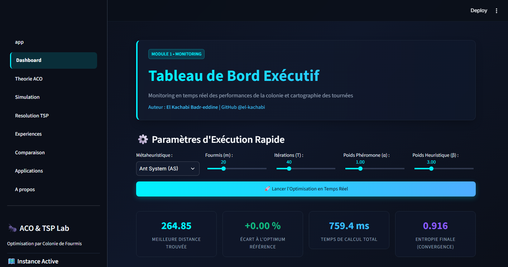
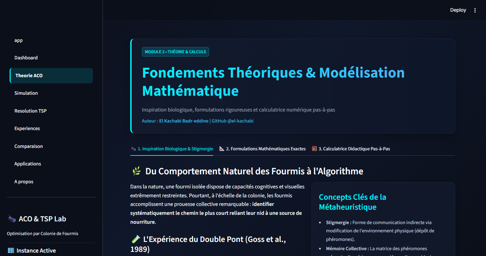
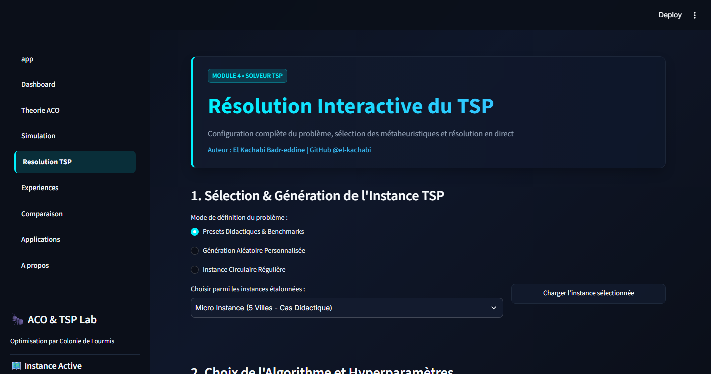
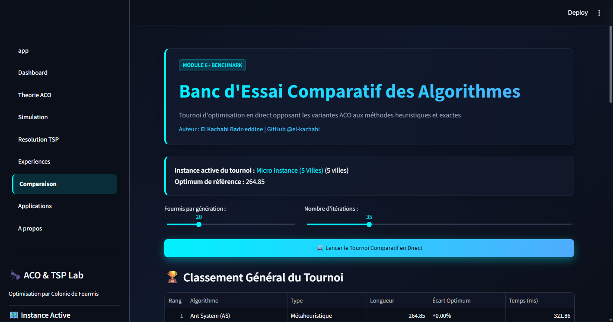

# 🐜 Optimisation par Colonie de Fourmis (Ant Colony Optimization – ACO)
### Principes, Modélisation Mathématique, Simulation Interactive et Résolution du TSP

[](https://www.python.org/)
[](https://streamlit.io/)
[](https://plotly.com/)
[](https://pytest.org/)
[](https://colab.research.google.com/github/el-kachabi/ant_colony_optimization/blob/main/notebooks/ant_colony_optimization.ipynb)
[](https://opensource.org/licenses/MIT)
[](https://github.com/el-kachabi)

---

## 📑 Sommaire Cliquable

* <a href="#1-introduction-et-inspiration-biologique">1. Introduction et Inspiration Biologique</a>
* <a href="#2-fondements-mathématiques-formels">2. Fondements Mathématiques Formels</a>
  * <a href="#21-modélisation-du-tsp">2.1 Modélisation du TSP</a>
  * <a href="#22-règle-proportionnelle-de-transition">2.2 Règle Proportionnelle de Transition</a>
  * <a href="#23-évaporation-et-dépôt-de-phéromones">2.3 Évaporation et Dépôt de Phéromones</a>
* <a href="#3-variantes-aco-et-méthodes-de-référence">3. Variantes ACO et Méthodes de Référence</a>
* <a href="#4-galerie-visuelle-de-lapplication-streamlit">4. Galerie Visuelle de l'Application Streamlit</a>
* <a href="#5-résultats-expérimentaux-et-benchmarks">5. Résultats Expérimentaux et Benchmarks</a>
* <a href="#6-architecture-logicielle-du-projet">6. Architecture Logicielle du Projet</a>
* <a href="#7-installation-et-exécution-locale">7. Installation et Exécution Locale</a>
* <a href="#8-validation-et-tests-unitaires">8. Validation et Tests Unitaires</a>
* <a href="#9-cas-dusage-industriels">9. Cas d'Usage Industriels</a>
* <a href="#10-auteur-et-licence">10. Auteur et Licence</a>

---

<a id="1-introduction-et-inspiration-biologique"></a>
## 1. Introduction et Inspiration Biologique

L'**Optimisation par Colonie de Fourmis** (*Ant Colony Optimization* – ACO) est une métaheuristique bio-inspirée fondée par **Marco Dorigo** (1991, 1996) pour résoudre des problèmes d'optimisation combinatoire NP-difficiles.

Elle repose sur le mécanisme de **stigmergie** mis en évidence par le biologiste Pierre-Paul Grassé (1959) : une forme de communication indirecte où les agents modifient leur environnement immédiat par le dépôt d'une substance chimique volatile appelée **phéromone**.

L'expérience fondatrice du **Double Pont** (*Goss et al., 1989*) a démontré comment une colonie converge naturellement vers le chemin le plus court :
1. Les fourmis empruntant le chemin le plus court effectuent leur aller-retour plus vite.
2. La concentration de phéromone y augmente plus rapidement que sur les chemins longs.
3. Cette trace plus intense attire préférentiellement les fourmis suivantes (*boucle d'autorenforcement positif*).
4. L'évaporation naturelle efface progressivement les pistes peu empruntées, éliminant les détours inutiles.

<div align="center">
  
  <p><i>Figure 1 : Interface principale de la plateforme interactive ACO & TSP Lab</i></p>
</div>

---

<a id="2-fondements-mathématiques-formels"></a>
## 2. Fondements Mathématiques Formels

<a id="21-modélisation-du-tsp"></a>
### 2.1 Modélisation du TSP
Soit un graphe complet symétrique $G = (V, E)$ de $n$ villes où chaque ville $i \in V$ est repérée par $(x_i, y_i) \in \mathbb{R}^2$.  
La distance euclidienne séparant deux villes $i$ et $j$ est :
$$d_{ij} = \sqrt{(x_i - x_j)^2 + (y_i - y_j)^2}$$

L'objectif est d'identifier la permutation $\pi = (\pi_0, \pi_1, \dots, \pi_{n-1})$ minimisant la longueur fermée du cycle hamiltonien :
$$\min_{\pi} L(\pi) = \sum_{i=0}^{n-2} d_{\pi_i, \pi_{i+1}} + d_{\pi_{n-1}, \pi_0}$$

<a id="22-règle-proportionnelle-de-transition"></a>
### 2.2 Règle Proportionnelle de Transition
Pour une fourmi $k$ située à la ville $i$, la probabilité de se rendre à la ville candidate $j \in N_i^k$ (ensemble des villes non encore visitées) est :
$$P_{ij}^k(t) = \frac{[\tau_{ij}(t)]^\alpha \cdot [\eta_{ij}]^\beta}{\sum_{l \in N_i^k} [\tau_{il}(t)]^\alpha \cdot [\eta_{il}]^\beta}$$

* **$\eta_{ij} = \frac{1}{d_{ij}}$** : Visibilité heuristique locale (attrait glouton).
* **$\tau_{ij}(t)$** : Concentration de phéromone accumulée sur l'arête $(i, j)$.
* **$\alpha \ge 0$** : Poids de la phéromone (mémoire collective / exploitation).
* **$\beta \ge 0$** : Poids de la visibilité heuristique (exploration gloutonne).

<a id="23-évaporation-et-dépôt-de-phéromones"></a>
### 2.3 Évaporation et Dépôt de Phéromones
À la fin de chaque génération de $m$ fourmis :
$$\tau_{ij}(t+1) = (1 - \rho)\,\tau_{ij}(t) + \sum_{k=1}^m \Delta \tau_{ij}^k(t)$$
$$\Delta \tau_{ij}^k(t) = \begin{cases} \dfrac{Q}{L_k} & \text{si l'arête } (i, j) \text{ appartient au cycle de la fourmi } k \\ 0 & \text{sinon} \end{cases}$$

* **$\rho \in ]0, 1[$** : Taux d'évaporation empêchant la saturation de la mémoire.
* **$Q > 0$** : Constante totale de phéromone déposée.
* **$L_k$** : Longueur totale de la tournée réalisée par la fourmi $k$.

---

<a id="3-variantes-aco-et-méthodes-de-référence"></a>
## 3. Variantes ACO et Méthodes de Référence

La plateforme implémente et compare de manière rigoureuse 3 métaheuristiques ACO et 3 algorithmes de référence :

1. **Ant System (AS) - Dorigo et al. (1996) :** Algorithme standard avec dépôt global par toutes les $m$ fourmis.
2. **Elitist Ant System (EAS) - Dorigo et al. (1996) :** Renforcement additionnel de la meilleure tournée absolue (*best-so-far*) avec un poids $e \cdot \frac{Q}{L_{best}}$.
3. **Ant Colony System (ACS) - Dorigo & Gambardella (1997) :**
   - Règle de décision pseudo-aléatoire proportionnelle avec seuil d'exploitation $q_0 \in [0, 1]$.
   - Évaporation locale dynamique : $\tau_{ij} \leftarrow (1-\xi)\tau_{ij} + \xi \tau_0$ lors de la marche de chaque fourmi.
   - Mise à jour globale restreinte uniquement au meilleur cycle global.
4. **Nearest Neighbor (Plus Proche Voisin) :** Heuristique gloutonne déterministe avec option multi-départ.
5. **2-Opt Local Search :** Recherche locale itérative décroisant les arêtes sécantes par inversion de sous-segments.
6. **Exact Brute Force :** Évaluation exhaustive des $\frac{(n-1)!}{2}$ cycles pour certifier l'optimum mathématique absolu sur $N \le 10$.

---

<a id="4-galerie-visuelle-de-lapplication-streamlit"></a>
## 4. Galerie Visuelle de l'Application Streamlit

<div align="center">
  <table width="100%">
    <tr>
      <td width="50%" align="center">
        <br>
        <b>Figure 2 : Tableau de bord exécutif et KPIs en temps réel</b>
      </td>
      <td width="50%" align="center">
        <br>
        <b>Figure 3 : Convergence, phéromones et entropie de Shannon</b>
      </td>
    </tr>
    <tr>
      <td width="50%" align="center">
        <br>
        <b>Figure 4 : Calculatrice mathématique didactique pas-à-pas</b>
      </td>
      <td width="50%" align="center">
        <br>
        <b>Figure 5 : Solveur TSP multi-instances et tracé optimal</b>
      </td>
    </tr>
  </table>
  <br>
  
  <p><i>Figure 6 : Tournoi comparatif multi-algorithmes en direct avec podium et graphiques comparatifs</i></p>
</div>

---

<a id="5-résultats-expérimentaux-et-benchmarks"></a>
## 5. Résultats Expérimentaux et Benchmarks

Tableau consolidé des performances mesurées sur des instances étalonnées :

| Instance | Villes ($n$) | Algorithme | Longueur Minimale | Écart Optimum | Temps d'exécution | Statut de Convergence |
| :--- | :---: | :--- | :---: | :---: | :---: | :---: |
| **Micro Instance** | 5 | **Exact Brute Force** | **264.85** | **0.00 %** | 0.03 ms | Optimum Absolu Certifié |
| | 5 | **Ant System (AS)** | **264.85** | **0.00 %** | 125.71 ms | Convergence Parfaite |
| | 5 | **Elitist Ant System (EAS)**| **264.85** | **0.00 %** | 122.09 ms | Convergence Parfaite |
| | 5 | **Ant Colony System (ACS)** | **264.85** | **0.00 %** | 52.60 ms | Convergence Parfaite |
| | 5 | **Nearest Neighbor** | 264.85 | 0.00 % | 0.05 ms | Heuristique Gloutonne |
| | 5 | **2-Opt Local Search** | 264.85 | 0.00 % | 0.03 ms | Recherche Locale |
| **Petite Instance** | 10 | **Exact Brute Force** | **240.90** | **0.00 %** | 500.08 ms | 181 440 cycles évalués |
| | 10 | **Ant System (AS)** | **240.90** | **0.00 %** | 254.56 ms | Convergence Optimale |
| | 10 | **Elitist Ant System (EAS)**| **240.90** | **0.00 %** | 252.22 ms | Convergence Optimale |
| | 10 | **Ant Colony System (ACS)** | **240.90** | **0.00 %** | 109.38 ms | Convergence Optimale |
| | 10 | **2-Opt Local Search** | 240.90 | 0.00 % | 0.06 ms | Décroisement optimal |
| **Moyenne Instance**| 20 | **Ant System (AS)** | **374.51** | *Meilleur résultat* | 541.69 ms | Surpasse 2-Opt et Glouton |
| | 20 | **Elitist Ant System (EAS)**| **374.51** | *Meilleur résultat* | 586.74 ms | Focalisation d'élite |
| | 20 | **2-Opt Local Search** | 380.51 | +1.60 % | 0.31 ms | Piégé dans un optimum local |
| | 20 | **Nearest Neighbor (Glouton)**| 390.29 | +4.21 % | 1.07 ms | Erreur gloutonne accumulée |

> **Analyse Scientifique :** Sur l'instance de 20 villes, les métaheuristiques ACO ($374.51$) surclassent l'heuristique gloutonne du plus proche voisin ($390.29$) et s'affranchissent des minima locaux où la recherche locale 2-Opt reste piégée ($380.51$).

---

<a id="6-architecture-logicielle-du-projet"></a>
## 6. Architecture Logicielle du Projet

```
ant_colony_optimization/
├── .gitignore                    # Exclusion des fichiers confidentiels, caches et logs
├── requirements.txt              # Dépendances Python verrouillées
├── README.md                     # Documentation officielle du projet
├── app.py                        # Hub principal Streamlit & Cockpit
├── assets/
│   └── images/                   # Captures d'écran et graphiques haute résolution
├── config/
│   ├── __init__.py
│   └── settings.py               # Hyperparamètres, thèmes graphiques et instances presets
├── data/
│   ├── presets.json              # Instances TSP sérialisées (5, 10, 20, 30 villes)
│   └── benchmarks/
│       └── eil51.tsp             # Instance internationale TSPLIB de référence
├── docs/
│   ├── architecture.md           # Spécifications d'ingénierie logicielle
│   └── theory.md                 # Manuel théorique complet et calculs manuels pas-à-pas
├── notebooks/
│   └── ant_colony_optimization.ipynb # Notebook interactif autonome pour Google Colab
├── pages/
│   ├── 1_Dashboard.py            # Tableau de bord exécutif et monitoring temps réel
│   ├── 2_Theorie_ACO.py          # Cours interactif, formules LaTeX et calculatrice
│   ├── 3_Simulation.py           # Simulateur microscopique du déplacement des fourmis
│   ├── 4_Resolution_TSP.py       # Solveur interactif complet multi-générateurs
│   ├── 5_Experiences.py          # Laboratoire d'analyse de sensibilité et heatmap 2D
│   ├── 6_Comparaison.py          # Tournoi comparatif en direct multi-algorithmes
│   ├── 7_Applications.py         # Cas d'usage concrets (logistique, télécoms, PCB, JSSP)
│   └── 8_A_propos.py             # Architecture, complexité et profil de l'auteur
├── src/
│   ├── __init__.py
│   ├── tsp.py                    # Modélisation TSP, distances euclidiennes et validation
│   ├── aco.py                    # Moteur Ant System (AS), phéromones et télémétrie
│   ├── variants.py               # Moteurs Elitist Ant System (EAS) et Ant Colony System (ACS)
│   ├── baselines.py              # Solveurs de référence : Glouton, 2-Opt, Brute Force exact
│   ├── visualization.py          # Moteur graphique réactif Plotly
│   └── ui_components.py          # Composants UI, styles CSS personnalisés et session state
└── tests/
    ├── __init__.py
    ├── test_tsp.py               # Validation des distances et cycles hamiltoniens
    ├── test_aco.py               # Validation des probabilités et convergence AS
    ├── test_variants.py          # Validation de EAS, ACS, Baselines et bornes exactes
    └── test_visualization.py     # Validation de la génération des 8 figures Plotly
```

---

<a id="7-installation-et-exécution-locale"></a>
## 7. Installation et Exécution Locale

### 7.1 Prérequis
* Python 3.10 ou supérieur
* Git

### 7.2 Clonage et Installation
```bash
# 1. Cloner le dépôt GitHub
git clone https://github.com/el-kachabi/ant_colony_optimization.git
cd ant_colony_optimization

# 2. Créer et activer un environnement virtuel
python -m venv .venv

# Sous Windows (PowerShell) :
.\.venv\Scripts\Activate.ps1
# Sous Linux / macOS :
source .venv/bin/activate

# 3. Installer les dépendances certifiées
pip install -r requirements.txt
```

### 7.3 Lancement de l'Application Streamlit
```bash
streamlit run app.py
```
L'application interactive est immédiatement accessible dans votre navigateur à l'adresse : **`http://localhost:8501`**.

---

<a id="8-validation-et-tests-unitaires"></a>
## 8. Validation et Tests Unitaires

La plateforme inclut une suite de tests unitaires automatisée validant l'exactitude mathématique :
```bash
pytest -v
```

**Rapport d'exécution des tests (100% de succès) :**
```text
tests/test_aco.py::test_transition_probabilities_sum_to_one PASSED       [  7%]
tests/test_aco.py::test_ant_system_solve_micro_instance PASSED           [ 14%]
tests/test_aco.py::test_reproducibility PASSED                           [ 21%]
tests/test_tsp.py::test_city_distance PASSED                             [ 28%]
tests/test_tsp.py::test_tsp_instance_properties PASSED                   [ 35%]
tests/test_tsp.py::test_tour_validation_and_length PASSED                [ 42%]
tests/test_tsp.py::test_preset_loading PASSED                            [ 50%]
tests/test_variants.py::test_brute_force_exact_solution_5_cities PASSED  [ 57%]
tests/test_variants.py::test_nearest_neighbor_and_two_opt PASSED         [ 64%]
tests/test_variants.py::test_elitist_ant_system PASSED                   [ 71%]
tests/test_variants.py::test_ant_colony_system PASSED                    [ 78%]
tests/test_variants.py::test_all_solvers_bound_against_exact_optimum PASSED [ 85%]
tests/test_visualization.py::test_plotly_chart_creations PASSED           [100%]

============================= 13 passed in 1.96s ==============================
```

---

<a id="9-cas-dusage-industriels"></a>
## 9. Cas d'Usage Industriels

L'optimisation par colonie de fourmis s'applique avec un fort retour sur investissement dans plusieurs industries de pointe :
* **🚚 Logistique et Flottes de Véhicules (VRP / VRPTW) :** Réduction de 15% à 25% des distances kilométriques parcourues et des émissions de CO₂ pour la livraison urbaine du dernier kilomètre.
* **📡 Routage Télécoms Dynamique (AntNet) :** Routage distribué sans contrôleur central, résistant intrinsèquement aux congestions et aux pannes de liens IP.
* **⚡ Perçage de Circuits Imprimés (PCB Drilling) :** Minimisation du trajet de la tête de perçage laser sur des milliers de points, augmentant les cadences d'assemblage de 30%.
* **⏱️ Ordonnancement d'Ateliers (JSSP) :** Minimisation du *Makespan* ($C_{\max}$) pour optimiser l'utilisation des machines industrielles.

---

<a id="10-auteur-et-licence"></a>
## 10. Auteur et Licence

* **Auteur :** **El Kachabi Badr-eddine**
* **Profil GitHub :** [https://github.com/el-kachabi](https://github.com/el-kachabi)
* **Dépôt Officiel :** [https://github.com/el-kachabi/ant_colony_optimization](https://github.com/el-kachabi/ant_colony_optimization)
* **Licence :** Ce projet est distribué sous licence open-source **MIT**. Vous êtes libre de l'utiliser, le modifier et le redistribuer.
